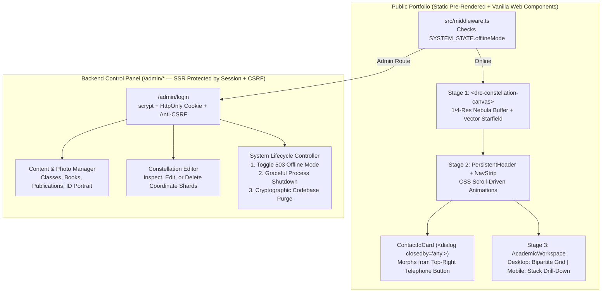

# Duncan R. Cordry (`DRC`) — Master Architectural & Engineering Blueprint

> **System Target:** 5-Year Zero-Maintenance Academic Portfolio & Observatory Control System  
> **Core Stack:** Astro v5 (Static-First Hybrid with `@astrojs/node` Standalone) · Vanilla Web Components · Native CSS Scroll-Driven Animations & Top-Layer APIs · Node 22 LTS Built-Ins (`node:fs`, `node:crypto`, `node:sqlite`)  
> **Aesthetic Direction:** "Lemmino-esque" Precision Documentary Typography + Generative Astronomical Cartography + Native-Grade Bipartite Software Interface

---

## Table of Contents
1. [Architecture, Hybrid Runtime & Component Tree](#1-architecture-hybrid-runtime--component-tree)
2. [Animation & Scroll Choreography](#2-animation--scroll-choreography)
3. [Canvas & Graphics Approach: Zero-GPU-Melt Night Sky](#3-canvas--graphics-approach-zero-gpu-melt-night-sky)
4. [Data Schema: Constellation Shards & Content Collections](#4-data-schema-constellation-shards--content-collections)
5. [View Layouts: Publications, Books, Classes & Expanding ID Card Modal](#5-view-layouts-publications-books-classes--expanding-id-card-modal)
6. [Mobile Translation Strategy (`< 768px` Touch & Portrait Viewports)](#6-mobile-translation-strategy--768px-touch--portrait-viewports)
7. [Secure Backend Control Panel ("Observatory Control")](#7-secure-backend-control-panel-observatory-control)
8. [The 5-Year Longevity Checklist](#8-the-5-year-longevity-checklist)
9. [High-Value Product Multipliers (\$999+ Valuation Tier)](#9-high-value-product-multipliers-999-valuation-tier)

---

## 1. Architecture, Hybrid Runtime & Component Tree

### 1.1 Why Astro Hybrid (`@astrojs/node` Standalone + Zero-Framework Islands)
To simultaneously achieve **static-grade speed and 5-year longevity** for public visitors while giving Professor Cordry a **total server control panel** (capable of editing classes, uploading photos, pruning constellations, taking the site offline, or purging source files), the project uses **Astro v5 with the `@astrojs/node` standalone adapter**:

* **Public Routes (`/` and `/publications/[slug]`):** Pre-rendered at build time (`prerender = true` by default) and gated only by an ultra-fast in-memory middleware flag (`SYSTEM_STATE.offlineMode`) that can instantly intercept traffic with a `503 Observatory Offline` page when toggled from the control panel.
* **Admin Control Panel (`/admin/*` and `/api/admin/*`):** Opts into server rendering (`export const prerender = false`) powered exclusively by **Node 22 LTS built-in modules** (`node:crypto`, `node:fs/promises`, `node:sqlite`, `node:child_process`)—requiring **zero third-party ORMs, auth libraries, or native C++ addons** that could break in 5 years.
* **Client Interactivity:** Uses **Standard Web Components (`customElements.define`)** instead of React or Solid, eliminating client-side framework hydration overhead and version churn.

### 1.2 Complete File & Component Tree

```
drc-portfolio/
├── astro.config.mjs                    # Astro v5 + @astrojs/node (standalone mode)
├── src/
│   ├── content.config.ts               # Astro Content Layer API (Zod schemas)
│   ├── middleware.ts                   # Offline switch gatekeeper + Admin session/CSRF guard
│   ├── data/
│   │   ├── system-state.json           # Persistent offline state, active constellation overrides
│   │   ├── constellations/
│   │   │   ├── index.json              # Master metadata & shard manifest
│   │   │   └── shards/                 # shard-00.json .. shard-49.json (100 constellations each)
│   │   ├── publications/               # Markdown (.md) papers
│   │   ├── books/                      # Markdown (.md) monographs
│   │   └── classes/                    # Markdown (.md) courses & weekly syllabi
│   ├── layouts/
│   │   ├── BaseLayout.astro            # Public shell, FOUC theme script, timeline-scope
│   │   └── AdminLayout.astro           # Hardened Observatory Control Panel shell
│   ├── pages/
│   │   ├── index.astro                 # Public master portfolio (Sky + Header + Academic UI)
│   │   ├── offline.astro               # 503 Maintenance / Observatory Offline screen
│   │   ├── publications/[slug].astro   # Deep-linkable static route for individual papers
│   │   ├── admin/
│   │   │   ├── login.astro             # Passkey / Password + TOTP Sign-In
│   │   │   ├── index.astro             # Observatory Control Dashboard (Classes, Books, Papers)
│   │   │   ├── constellations.astro    # Interactive Constellation Inspector & Vertex Editor
│   │   │   ├── media.astro             # Portrait & Book Cover Uploader / Cropper
│   │   │   └── system.astro            # Server Offline Switch & Scorched-Earth Code Purge
│   │   └── api/admin/
│   │       ├── auth.ts                 # POST login/logout (scrypt + HMAC-SHA256 HttpOnly cookie)
│   │       ├── content.ts              # POST/PUT/DELETE classes, books, publications + rebuild
│   │       ├── media.ts                # POST multipart photo replacement & WebP/AVIF write
│   │       ├── constellations.ts       # PATCH/DELETE individual constellation coordinates
│   │       └── lifecycle.ts            # POST toggle-offline | kill-server | purge-codebase
│   ├── components/
│   │   ├── sky/
│   │   │   └── ConstellationStage.astro  # <drc-constellation-canvas> + RA/Dec HUD
│   │   ├── chrome/
│   │   │   ├── PersistentHeader.astro    # Scroll-shrinking "Duncan R. Cordry" -> "DRC"
│   │   │   ├── ContactIdCard.astro       # Expanding telephone button -> Faculty ID Card <dialog>
│   │   │   ├── ThemeToggle.astro         # <drc-theme-toggle> 2-state color-scheme controller
│   │   │   └── NavStrip.astro            # Horizontal parallax strip (PUBLICATIONS | BOOKS | CLASSES)
│   │   └── workspace/
│   │       ├── AcademicWorkspace.astro   # Responsive desktop split-pane / mobile stack-drill-down
│   │       ├── PublicationsWorkspace.astro
│   │       ├── BooksWorkspace.astro
│   │       └── ClassesWorkspace.astro
│   └── styles/
│       ├── tokens.css                  # OKLCH color tokens, light-dark(), fluid typography
│       ├── scroll-choreography.css     # CSS Scroll-Driven Animations + snap points
│       ├── workspace-responsive.css    # Desktop bipartite grid + Mobile stack-drill-down
│       └── contact-id-card.css         # Top-layer @starting-style morphing ID card styles
```

### 1.3 System Architecture Diagram



---

## 2. Animation & Scroll Choreography

### 2.1 Zero-Dependency Native Scroll Architecture
To prevent dependency breakage and scroll-jacking bugs on mobile trackpads/touchscreens, the scroll system uses **Native CSS Scroll Snap** + **CSS Scroll-Driven Animations (`scroll()` and `view-timeline`)**, with a lightweight **Vanilla JS fallback (`IntersectionObserver` + passive `scroll` listener)** for browsers without `animation-timeline` support.

* **Stage 1 (`0vh – 100vh`):** Full-screen generative night sky. Constellation name and J2000.0 coordinates appear in the lower-left HUD.
* **Stage 2 (`100vh – 200vh`):** The night sky fades to `opacity: 0.25` as the full `"Duncan R. Cordry"` title bar rises into position.
* **Stage 3 (`200vh`):** On the second swipe, the title bar morphs into `"DRC"` docked permanently to the top-left, the vintage telephone and day/night icons dock to the top-right, the horizontal Navigation Strip (`PUBLICATIONS — BOOKS — CLASSES`) scrubs into alignment, and the Academic Interface locks into the viewport.

### 2.2 Scroll-Driven CSS (`src/styles/scroll-choreography.css`)

```css
html {
  scroll-snap-type: y mandatory;
  scrollbar-width: none; /* No visible browser scrollbars */
  timeline-scope: --stage-sky, --stage-header, --stage-workspace;
}

.snap-stage {
  block-size: 100dvh;
  scroll-snap-align: start;
  scroll-snap-stop: always;
}

#stage-1 { view-timeline: --stage-sky block; }
#stage-2 { view-timeline: --stage-header block; }
#stage-3 { view-timeline: --stage-workspace block; }

@keyframes fade-sky {
  0%   { opacity: 1; }
  50%  { opacity: 0.25; }
  100% { opacity: 0.04; }
}

@keyframes dock-header-full {
  to { opacity: 0; transform: translate3d(-1.5rem, -0.5rem, 0) scale(0.75); }
}

@keyframes dock-header-monogram {
  from { opacity: 0; transform: translate3d(1rem, 0, 0); }
  to   { opacity: 1; transform: translate3d(0, 0, 0); }
}

@keyframes scrub-nav-strip {
  from { transform: translate3d(18%, 0, 0); }
  to   { transform: translate3d(-12%, 0, 0); }
}

@supports ((animation-timeline: scroll()) and (animation-range: 0% 100%)) {
  .sky-backdrop {
    animation: fade-sky auto linear both;
    animation-timeline: scroll(block root);
    animation-range: 0dvh 200dvh;
  }

  .header-title-full {
    transform-origin: left center;
    animation: dock-header-full auto linear both;
    animation-timeline: scroll(block root);
    animation-range: 100dvh 180dvh;
  }

  .header-title-drc {
    animation: dock-header-monogram auto linear both;
    animation-timeline: scroll(block root);
    animation-range: 120dvh 200dvh;
  }

  .nav-strip-track {
    animation: scrub-nav-strip auto linear both;
    animation-timeline: scroll(block root);
    animation-range: 80dvh 200dvh;
  }
}

@media (prefers-reduced-motion: reduce) {
  .sky-backdrop, .header-title-full, .header-title-drc, .nav-strip-track {
    animation: none !important;
    transform: none !important;
  }
}
```

### 2.3 Snap State Synchronization (`scrollsnapchange` + Fallback)

```javascript
if ('onscrollsnapchange' in HTMLElement.prototype) {
  window.addEventListener('scrollsnapchange', (event) => {
    const snapped = event.snapTargetBlock;
    if (snapped) document.body.dataset.stage = snapped.id;
  });
} else {
  const stageObserver = new IntersectionObserver((entries) => {
    for (const entry of entries) {
      if (entry.isIntersecting) document.body.dataset.stage = entry.target.id;
    }
  }, { threshold: 0.6 });
  document.querySelectorAll('.snap-stage').forEach((el) => stageObserver.observe(el));
}
```

---

## 3. Canvas & Graphics Approach: The "Mythological Artefact" & Astrophysical Realism Engine

Most web starfields look artificial because they draw uniform white dots connected by flat `1px` lines over simple RGB gradients. To make Professor Cordry’s landing sky feel simultaneously like **looking through a high-altitude glass-plate astrograph** and **unearthing a 17th-century brass-and-obsidian celestial artifact** (inspired by Johannes Hevelius’s *Uranographia*, Andreas Cellarius’s *Harmonia Macrocosmica*, and the Voyager Golden Record), the engine is built around **five physical and cartographic layers**:

### 3.1 Layer 1: Domain-Warped Milky Way & Interstellar Dust Extinction (`1/4`-Res Offscreen Buffer)
Real galactic nebulas are not smooth circles—they are filamentary clouds carved by **interstellar dust extinction (the Great Rift and dark Bok globules)**.
* **Single-Execution Offscreen Pass ($\le 512 \times 512\text{px}$):** Rendered once on load inside an offscreen `<canvas>` (or `OffscreenCanvas` worker) rotated along a galactic plane angle $\theta \in [28^\circ, 42^\circ]$.
* **Domain-Warped Fractional Brownian Motion (fBm):** Uses a 3-octave 2D Simplex noise function warped by itself:
  $$\mathbf{q} = \big(\text{fbm}(\mathbf{p}),\ \text{fbm}(\mathbf{p} + (5.2, 1.3))\big), \qquad I_{\text{nebula}}(\mathbf{p}) = \text{fbm}(\mathbf{p} + 2.8\,\mathbf{q})$$
* **Dual-Pass Radiative Transfer:**
  1. *Emission & Star Cloud Pass (`'screen'`):* Blends warm galactic-core starlight (`oklch(38% 0.05 75)`), outer-arm reflection sapphire (`oklch(22% 0.06 260)`), and subtle ionized $H\alpha$ rose knots (`oklch(32% 0.08 15)`).
  2. *Dark Dust Rift Pass (`'multiply'`):* Carves ragged, high-contrast dark dust lanes down the center of the Milky Way spine where background star density increases along the edges.
* **Hardware Upscale & Glass-Plate Grain:** Upscaling the $512 \times 512$ buffer onto the full viewport with `ctx.imageSmoothingQuality = 'high'` provides a zero-cost Gaussian blur, topped with a tiled $128 \times 128$ monochrome blue-noise grain (`3%` opacity, `mix-blend-mode: soft-light` inside an `isolation: isolate` wrapper) so dark OLED/IPS monitors never show 8-bit banding.

### 3.2 Layer 2: Planckian Blackbody Starlight & Optical Point Spread Function (PSF)
* **Harvard Spectral Color Index ($O, B, A, F, G, K, M$):** Every star is assigned a realistic color temperature $T_{\text{eff}} \in [3000\text{K}, 25000\text{K}]$ derived from its seed:
  * **Blue-White Giants ($O/B$):** `oklch(86% 0.065 255)`
  * **Sirius Frost-White ($A/F$):** `oklch(96% 0.015 245)`
  * **Solar Ivory ($G$):** `oklch(95% 0.035 85)`
  * **Amber/Crimson Supergiants ($K/M$):** `oklch(82% 0.115 55)`
* **3-Zone Optical Airy Disk & Halation:** Bright stars ($m_V < 3.0$) are stamped from pre-rendered $64 \times 64\text{px}$ sprite stamps featuring:
  1. A saturated white-hot Airy core ($r = 1.2\text{px}$, $\alpha = 1.0$).
  2. A spectral-tinted inner corona ($r = 4.5\text{px}$, $\alpha = 0.45$).
  3. An inverse-square atmospheric halation envelope $I(r) = I_0 / (1 + (r/r_0)^2)^2$ ($r = 18\text{px}$, $\alpha = 0.08$) that makes stars look like they are genuinely radiating light into humid night air.
* **Fraunhofer Diffraction Spikes:** The primary $\alpha$ and $\beta$ stars of the active constellation receive hair-thin $0.5\text{px}$ 4-point cross spikes tilted at $15^\circ$, scaled proportionally to apparent luminosity $L \propto 10^{-0.4 m_V}$.

### 3.3 Layer 3: The "Mythological Artefact" Cartography (Engraved Gold-Leaf & Astrolabe Geometry)
To evoke a sacred astronomical instrument rather than a digital graph:

```
                      ·  .  .  |  .  .  ·   <-- Sweeping Declination Great Circle Arc
                               │                (R = 1400px, graduated 1° vernier ticks)
                           ╭───┴───╮
                 α (Alpha) │  (✦)  │        <-- Double Concentric Astrolabe Reticle
                           ╰───┬───╯            + 9px "Breathing Halo" (line never touches star)
                               ║
                               ║  <-- Double-hairline Champagne Silverpoint Stroke
                               ║      (Primary edge + 1.5px intaglio shadow line)
                               ◯  β (Beta)
                              ╱ ╲  θ = 47°12' <-- Inscribed geometric angle arc
                             ╱   ╲
                   γ (Gamma) ◯ ··· ◯  δ (Delta) <-- Dotted ghost construction chord
```

1. **The $9\text{px}$ "Breathing Halo" Gap:** Constellation lines **never pierce or touch the stars**. For an edge from $\mathbf{p}_A$ to $\mathbf{p}_B$ with unit vector $\hat{\mathbf{u}}$, the stroke begins at $\mathbf{p}_A + 9\hat{\mathbf{u}}$ and terminates at $\mathbf{p}_B - 9\hat{\mathbf{u}}$, preserving a dark sanctuary around every star core.
2. **Intaglio Silverpoint & Gold-Leaf Ink:** Primary edges are drawn in warm antique silverpoint (`oklch(86% 0.04 82 / 0.58)`) paired with a parallel $0.5\text{px}$ copperplate shadow line offset by $1.5\text{px}$ (`oklch(75% 0.06 75 / 0.16)`).
3. **Celestial Mechanics & Astrolabe Overlays:**
   * **Concentric Astrolabe Reticles:** The brightest star ($\alpha$) is framed by a solid inner hairline ring ($r = 7\text{px}$) and an outer dashed vernier ring ($r = 16\text{px}$) with 4 cardinal tick marks.
   * **Bayer Greek Designations ($\alpha, \beta, \gamma, \delta, \epsilon$):** Rendered beside each vertex in classical engraved italic (`italic 11px Georgia, serif`, `oklch(85% 0.03 82 / 0.75)`).
   * **Sweeping Great-Circle Meridian:** A wide stereographic arc ($R \approx 1400\text{px}$) passes through the constellation's geometric barycenter with $1^\circ$ graduation ticks and a microscopic `EPOCH J2000.0` stamp.
   * **Ghost Mythos Chords & Inscribed Angles:** Non-adjacent vertices are connected by ultra-faint dotted construction chords (`setLineDash([1, 5])`, $\alpha = 0.16$) and small angle-bisector arcs ($\theta = 47^\circ 12'$) like an ancient geometric proof.

### 3.4 Layer 4: "The Astrolabe Awakening" (3.2-Second Dream Choreography + Zero-Melt Idle State)
1. **Movement I (`0.0s – 0.8s`) — *Optical Dark Adaptation*:** The Milky Way and background starfield are present immediately; the 5–9 constellation stars slowly bloom from dim pinpoints to their full Airy-disk halation.
2. **Movement II (`0.5s – 1.8s`) — *Celestial Surveying*:** The sweeping Great-Circle meridian arc draws across the sky while the concentric astrolabe reticle rings rotate $45^\circ$ into lock around the $\alpha$ and $\beta$ stars.
3. **Movement III (`1.2s – 2.6s`) — *Mythological Filament Tracing*:** Silverpoint edges trace outward from the $\alpha$ star along the graph's minimum spanning tree (`easeOutQuart`), stopping $9\text{px}$ short of each star as the Bayer Greek letters (`α`, `β`, `γ`) fade in.
4. **Movement IV (`2.2s – 3.2s` & Idle) — *Atmospheric Scintillation & Stereographic Parallax*:**
   * Once the 3.2s draw-in completes, the background sky + Milky Way is locked into a static cached `ImageBitmap`.
   * **Dream Parallax without GPU Drain:** The foreground constellation layer and background sky sit on two separate hardware-composited planes. Subtle cursor movement on desktop (or gentle scroll/tilt on mobile) shifts the foreground constellation plane by $\pm 6\text{px}$ and the deep sky by $\pm 1.5\text{px}$ via compositor `transform: translate3d(...)`, making the engraved artifact float in 3D depth above the cosmos at **0% rasterization cost**.

### 3.5 Layer 5: Dual-Soul Theme Palette (Night Observatory vs. 17th-Century Vellum Atlas)
* **Night Mode (`dark`):** Deep obsidian sky (`oklch(9% 0.015 265)`), bioluminescent nebula rifts, Planckian starlight halation, and champagne-silver astrolabe engravings.
* **Day Mode (`light`):** Toggling the top-right day/night icon transforms the canvas into an **Archival Vellum & Brass Star Chart** (`oklch(95.5% 0.018 82)` warm parchment background, charcoal-sepia ink wash nebulas, oxidized copperplate linework `oklch(32% 0.05 55)`, and vermilion astrolabe degree ticks `oklch(48% 0.16 28)`).

---

## 4. Data Schema: Constellation Shards & Content Collections

### 4.1 Sharded Constellation Coordinate Format (`src/data/constellations/shards/shard-XX.json`)
5,000 constellations are split into 50 JSON shards of 100 constellations each (`~12KB` gzipped per shard), with coordinates quantized to integers $0\dots10000$:

```json
[
  {
    "id": "DRC-0412",
    "name": "Vela Minor",
    "ra": "09h 34m 12.4s",
    "dec": "-42° 18' 05\"",
    "epoch": "J2000.0",
    "stars": [
      [1840, 3120, 1.2],
      [2910, 2450, 0.8],
      [4620, 3890, 1.0],
      [6105, 5120, 0.5],
      [7820, 4410, 0.9]
    ],
    "edges": [[0, 1], [1, 2], [2, 3], [2, 4]]
  }
]
```

### 4.2 Astro v5 Content Layer Schema (`src/content.config.ts`)

```typescript
import { defineCollection, z } from 'astro:content';
import { glob } from 'astro/loaders';

const publications = defineCollection({
  loader: glob({ pattern: '**/*.md', base: './src/data/publications' }),
  schema: z.object({
    id: z.string(),
    title: z.string(),
    subtitle: z.string().optional(),
    year: z.number().int(),
    venue: z.string(),
    volumeIssue: z.string().optional(),
    coAuthors: z.array(z.string()).default([]),
    abstract: z.string(),
    doi: z.string().url().optional(),
    pdfUrl: z.string().optional(),
    citationBibtex: z.string(),
  }),
});

const books = defineCollection({
  loader: glob({ pattern: '**/*.md', base: './src/data/books' }),
  schema: z.object({
    id: z.string(),
    title: z.string(),
    subtitle: z.string().optional(),
    year: z.number().int(),
    publisher: z.string(),
    isbn: z.string(),
    pages: z.number().int(),
    coverImage: z.string(),
    synopsis: z.string(),
    endorsements: z.array(z.object({
      quote: z.string(),
      sourceTitle: z.string(),
      citeUrl: z.string().url().optional(),
    })).default([]),
    chapters: z.array(z.object({
      number: z.string(),
      title: z.string(),
      summary: z.string(),
    })).default([]),
    purchaseLinks: z.array(z.object({
      label: z.string(),
      url: z.string().url(),
    })).default([]),
  }),
});

const classes = defineCollection({
  loader: glob({ pattern: '**/*.md', base: './src/data/classes' }),
  schema: z.object({
    courseCode: z.string(),
    title: z.string(),
    academicYear: z.string(),
    term: z.string(),
    level: z.enum(['Undergraduate', 'Graduate', 'Seminar']),
    schedule: z.string(),
    syllabusPdf: z.string().optional(),
    summary: z.string(),
    weeks: z.array(z.object({
      weekNumber: z.string(),
      topic: z.string(),
      readings: z.array(z.string()),
    })).default([]),
  }),
});

export const collections = { publications, books, classes };
```

---

## 5. View Layouts: Publications, Books, Classes & Expanding ID Card Modal

### 5.1 View Caching Between `PUBLICATIONS`, `BOOKS`, and `CLASSES`
All three top-level workspaces live in the DOM under `<main id="academic-interface">` and switch instantaneously using `content-visibility: hidden` (preserving scroll position and open accordion state without layout/paint overhead):

```css
.spa-view.inactive {
  content-visibility: hidden;
  position: absolute;
  inset-inline: 0;
  pointer-events: none;
}

@supports not (content-visibility: hidden) {
  .spa-view.inactive {
    display: none;
  }
}
```

### 5.2 `BOOKS` View (`BooksWorkspace.astro`)
* **Left Pane (Subgrid Spine/Cover Catalog):** Uses `grid-template-columns: repeat(auto-fill, minmax(140px, 1fr))` with `grid-template-rows: subgrid` (and a preceding `grid-template-rows: auto 1fr auto` fallback) so `2:3` cover thumbnails, titles, and publisher imprints line up across every card.
* **Right Pane (Size-Aware Monograph Dossier):** Declares `container: book-dossier / inline-size` so collapsing the left pane automatically expands the book cover + metadata lockup (`@container book-dossier (min-width: 560px)`), followed by `<figure><blockquote cite="...">` endorsements and `<details name="book-chapters">` exclusive chapter accordions.

### 5.3 `CLASSES` View (`ClassesWorkspace.astro`)
* **Left Pane (Semester Ledger):** Features a `<search>` landmark with level filter pills (`flex-wrap: wrap; flex-wrap: balance;`) and chronological course rows in tabular monospace (`ASTR 312 · F26 · SEM`).
* **Right Pane (Course Briefing & Syllabus):** Displays a 4-column telemetry strip (`Term`, `Level`, `Schedule`, `Syllabus PDF`) and weekly modules built with exclusive `<details name="syllabus-week">` accordions.

### 5.4 Expanding Telephone Button $\rightarrow$ Faculty ID Card Modal (`ContactIdCard.astro`)
* **Declarative Invocation & Light-Dismiss:** Triggered by `<button commandfor="contact-id-card" command="show-modal">` on `<dialog id="contact-id-card" closedby="any">`.
* **Top-Right Button Morph:** Tethered to the telephone icon via CSS Anchor Positioning (`anchor-name: --contact-btn`) with `transform-origin: top right`. Uses `@starting-style`, `transition-behavior: allow-discrete`, and `overlay` to expand from `scale(0.11)` + a circular `clip-path` into the full ID card containing Professor Cordry's portrait (`4:5` ratio), title, office telemetry, and `[ ✉ Email Duncan R. Cordry ]` button, and shrinks back into the button when clicking anywhere outside (including the `canTransitionDisplay()` probe and `data-closing` fallback for Firefox/Safari).

---

## 6. Mobile Translation Strategy (`< 768px` Touch & Portrait Viewports)

Translating a desktop bipartite software interface and scroll-scrubbed header to mobile requires adapting to **single-thumb ergonomics**, **portrait aspect ratios**, and **OS edge-swipe navigation** without duplicating templates.

### 6.1 Mobile Layout Transformation Matrix

| System Component | Desktop (`>= 768px`) | Mobile (`< 768px` Portrait / Touch) |
| :--- | :--- | :--- |
| **1. Constellation Sky** | Landscape bounding box `[0.15, 0.85]` | Portrait safe-zone; wide constellations auto-rotate $90^\circ$ so they fill vertical screens cleanly. Coordinates HUD docks above the bottom safe-area inset (`env(safe-area-inset-bottom)`). |
| **2. Shrinking Header & Icons** | Full `"Duncan R. Cordry"` morphs to `"DRC"` on left; icons on right. | Compact `"Duncan R. Cordry"` (`clamp(1.25rem, 5vw, 1.75rem)`) morphs to `"DRC"`. Telephone and Theme toggle buttons have a minimum **`48px × 48px` tap target** (`@media (pointer: coarse)`). |
| **3. Horizontal Nav Strip** | Scrubs horizontally via scroll timeline; all 3 items visible. | Acts as a sticky `48px`-tall horizontal pill bar (`PUBLICATIONS` · `BOOKS` · `CLASSES`) with `scroll-snap-type: x proximity` and active underline indicator. |
| **4. Bipartite Academic Panes** | Side-by-side CSS Grid (`360px 1fr`) with collapsible left sidebar. | Converts into a **2-Stop Horizontal CSS Scroll-Snap Stack (`stack-drill-down`)** where View 0 is the Index List and View 1 is the Full-Screen Reader/Dossier! |
| **5. Expanding Contact ID Card** | `360px` card anchored to top-right button corner. | Expands from the top-right telephone button to `calc(100dvw - 1.5rem)` width centered near the top of the screen, keeping `transform-origin: top right` so it still visually unfolds out of and shrinks back into the button. |

### 6.2 Mobile Master-Detail Navigation: The Native `Stack Drill-Down` Pattern
On screens narrower than `768px`, displaying the Publication List and Publication Reader side-by-side is unusable. Instead of hiding/showing divs with jarring jumps, the `.workspace-split` container transforms into a **Horizontal Scroll-Snap Drill-Down Stack**:

```
   MOBILE VIEW 0 (Index Snap Stop)          MOBILE VIEW 1 (Reader Snap Stop)
+-----------------------------------+    +-----------------------------------+
| DRC                     [☎]  [◐]  |    | DRC                     [☎]  [◐]  |
| PUBLICATIONS  ·  BOOKS  ·  CLASSES|    | PUBLICATIONS  ·  BOOKS  ·  CLASSES|
|-----------------------------------|    |-----------------------------------|
| [ Search papers...              ] |    | [ ◄ Back to Publications ] [PDF↓] |
|-----------------------------------|    |-----------------------------------|
| 2024                              |    | THE GEOMETRY OF EPISTEMIC SPACE   |
| > Epistemic Horizons in...    [→] | ===> Duncan R. Cordry · MIT Press 2024 |
|   Astrophysical Journal · V.42    |    |                                   |
|                                   |    | Abstract — We demonstrate that    |
| > Metric Tensors & Parallax   [→] | <=== equatorial coordinate systems...  |
|   MNRAS · V.518                   |    | (Swipe right anywhere to return)  |
+-----------------------------------+    +-----------------------------------+
```

1. **Native Finger-Driven Swipe Back:** On mobile, `.workspace-split` sets `display: grid; grid-auto-flow: column; grid-auto-columns: 100%; overflow-x: auto; scroll-snap-type: x mandatory; overscroll-behavior-x: none;`.
2. **Scroll-Driven Card Stack Parallax (`view(inline)`):** Inside `@supports (animation-timeline: view())`, the inner `.pane-content` of the index view dims (`brightness(0.8)`) and translates (`translateX(35%)`) as the reader card slides over it from the right, with a soft left-edge shadow on the incoming reader view.Transforms are applied strictly to `.pane-content` (the child), **never** to the snap target `.workspace-pane` itself, preventing snap geometry feedback glitches.
3. **Single Source of Truth (`scrollsnapchange` + `inert` + History Sync):**
   * Tapping a paper/book/course link pushes a browser history entry (`history.pushState({ depth: 1, itemId }, '', url)`) and scrolls one viewport width right (`stack.scrollBy({ left: stack.clientWidth, behavior: 'auto' })`).
   * When the horizontal snap settles, `scrollsnapchange` (`event.snapTargetInline`, with an `IntersectionObserver({ root: stack, threshold: 1 })` fallback for Safari/Firefox) marks the off-screen pane `inert` (so screen readers and tab focus cannot leak into the hidden pane), moves focus using `.focus({ preventScroll: true })`, and reconciles `history.back()` when the user swipes back with their thumb.
   * If a mobile visitor lands directly on a deep link (`/publications/epistemic-horizons`) and taps `[ ◄ Back ]`, the controller detects `atDeepLinkRoot` and synthesizes the root index entry on the left before smooth-scrolling back, so they aren't ejected from the site.

```css
/* src/styles/workspace-responsive.css */
@media (max-width: 767px) {
  .workspace-split {
    block-size: calc(100dvh - var(--chrome-height, 6.5rem));
    display: grid;
    grid-auto-flow: column;
    grid-auto-columns: 100%;
    grid-template-rows: 100%;
    overflow-x: auto;
    scroll-snap-type: x mandatory;
    overscroll-behavior-x: none;
    scrollbar-width: none;
  }

  .workspace-split::-webkit-scrollbar {
    display: none;
  }

  @media (prefers-reduced-motion: no-preference) {
    .workspace-split {
      scroll-behavior: smooth;
    }
  }

  .workspace-pane-left,
  .workspace-pane-right {
    scroll-snap-align: start;
    scroll-snap-stop: always;
    block-size: 100%;
    overflow: clip;
  }

  /* Separate inner wrapper receives parallax transform so snap geometry stays stable */
  .pane-inner-scroll {
    inline-size: 100%;
    block-size: 100%;
    overflow-y: auto;
    overscroll-behavior-y: contain;
    background: var(--bg-surface);
  }

  @supports (animation-timeline: view()) {
    .workspace-pane-left .pane-inner-scroll {
      animation: mobile-stack-parallax linear both;
      animation-timeline: view(inline);
      animation-range: exit 0% exit 100%;
    }

    .workspace-pane-right .pane-inner-scroll {
      animation: mobile-stack-shadow linear both;
      animation-timeline: view(inline);
      animation-range: entry 0% exit 100%;
    }

    @keyframes mobile-stack-parallax {
      to {
        transform: translateX(65%);
        filter: brightness(0.8);
      }
    }

    @keyframes mobile-stack-shadow {
      0%, 100% { box-shadow: 0 0 1.5rem transparent; }
      25%, 75% { box-shadow: -0.5rem 0 1.5rem oklch(0% 0 0 / 0.35); }
    }
  }
}
```

---

## 7. Secure Backend Control Panel ("Observatory Control")

Professor Cordry’s backend interface (`/admin`) is designed with the same austere, high-contrast "Lemmino Mission Control" aesthetic as the front-end, giving him complete sovereignty over content, media, constellations, and server lifecycle.

### 7.1 Zero-Dependency Hardened Security Architecture
To ensure the backend never suffers from abandoned npm auth libraries:
1. **Password + Optional Passkey / TOTP Verification (`node:crypto`):**
   * Admin credentials are stored as an environment variable (`DRC_ADMIN_HASH`) generated via `crypto.scryptSync(password, salt, 64)`.
   * Upon valid sign-in, the server issues a stateless, signed `HttpOnly; Secure; SameSite=Strict; Path=/` session token (`HMAC-SHA256` with `DRC_SESSION_SECRET` + expiration timestamp) and a paired **anti-CSRF token** injected into `<form method="POST">` hidden inputs.
   * Rate-limiting is enforced in-memory inside `src/middleware.ts` (max 5 failed attempts per 15 minutes per IP).
2. **Accessible, Standards-Compliant Sign-In Form (`/admin/login.astro`):**
   * Follows modern form autofill and mobile keyboard rules:

```html
<form action="/api/admin/auth" method="POST" class="admin-login-form">
  <input type="hidden" name="csrf_token" value={csrfToken} />
  <h1>Observatory Control // Sign In</h1>

  <div class="form-group">
    <label for="email">Administrator Email</label>
    <input
      type="email"
      id="email"
      name="email"
      autocomplete="username"
      spellcheck="false"
      enterkeyhint="next"
      required
    />
  </div>

  <div class="form-group">
    <label for="current-password">Master Passphrase</label>
    <div class="password-input-wrap">
      <input
        type="password"
        id="current-password"
        name="password"
        autocomplete="current-password"
        enterkeyhint="done"
        required
      />
      <button type="button" id="toggle-password" aria-pressed="false" aria-label="Show password">
        Show
      </button>
    </div>
  </div>

  <button type="submit" class="btn-primary">Sign In to Observatory Control</button>
</form>
```

### 7.2 Control Panel Capabilities & Modules

```
+------------------------------------------------------------------------------------+
| OBSERVATORY CONTROL // ADMIN: D. R. CORDRY          [ STATUS: ONLINE ● ] [Sign Out]|
|------------------------------------------------------------------------------------|
| [ 01 Content & Classes ] [ 02 Media & ID Photo ] [ 03 Constellations ] [ 04 System]|
+------------------------------------------------------------------------------------+
| MODULE 03: CONSTELLATION CATALOG INSPECTOR (4,998 Active Shards)                   |
|------------------------------------------------------------------------------------|
| [ Search ID or Name: "DRC-0412" ]   [ + New Constellation ]                        |
|                                                                                    |
| +-----------------------------------+  +-----------------------------------------+ |
| | INTERACTIVE CANVAS PREVIEW        |  | CONSTELLATION TELEMETRY                 | |
| |                                   |  | ID:    [ DRC-0412                     ] | |
| |        * (1)                      |  | Name:  [ Vela Minor                   ] | |
| |       / \                         |  | RA:    [ 09h 34m 12.4s                ] | |
| |  (0) *   * (2) --- * (4)          |  | Dec:   [ -42° 18' 05"                 ] | |
| |           \                       |  |                                         | |
| |            * (3)                  |  | VERTICES (Click canvas to drag/delete)  | |
| |                                   |  | #0: X=1840, Y=3120, Mag=1.2        [✕]  | |
| | [Drag Star] [Link Edge] [Delete]  |  | #1: X=2910, Y=2450, Mag=0.8        [✕]  | |
| +-----------------------------------+  |                                         | |
|                                        | [ Save Shard ]  [ Delete Constellation ]| |
|                                        +-----------------------------------------+ |
+------------------------------------------------------------------------------------+
```

#### Module 1: Classes, Books & Publications Manager (`/admin/index.astro`)
* **Structured Form Editor:** Uses `<fieldset>` and `<legend>` groups with radio buttons (`<input type="radio">`) for selecting exclusive course levels (`Undergraduate`, `Graduate`, `Seminar` — fewer than 6 options, zero-click scanning) and dynamic field rows for weekly syllabus items.
* **Atomic Filesystem Persistence:** Submitting the form sends a `POST` request with `csrf_token` to `/api/admin/content`. The endpoint validates the payload against the exact same Zod schema from `src/content.config.ts`, writes the clean frontmatter + Markdown file atomically to `src/data/{classes|books|publications}/[slug].md`, and updates the live cache so changes appear immediately without needing an external CI pipeline.

#### Module 2: Portrait & Media Studio (`/admin/media.astro`)
* **Interactive Cropper & Replacement:** Allows Professor Cordry to upload a new Faculty ID Card portrait, book cover, or course syllabus PDF.
* **Client-Side Canvas Aspect-Ratio Crop + Server Write:** A lightweight `<canvas>` cropper enforces the `4:5` ID card portrait aspect ratio (or `2:3` book cover ratio), exports a high-efficiency `.webp` blob right in the browser (`canvas.toBlob(cb, 'image/webp', 0.88)`), and uploads it to `/api/admin/media`, which atomically replaces `/public/images/duncan-cordry-portrait.webp`—eliminating any server-side dependency on `sharp` or `libvips` C++ binaries!

#### Module 3: Individual Constellation Inspector & Editor (`/admin/constellations.astro`)
* **Search & Shard Loader:** Searches across `src/data/constellations/index.json` by ID (`DRC-0412`) or name (`Vela Minor`), loading the specific `shard-XX.json`.
* **Visual Canvas Vertex Editor:** Renders the constellation on an interactive HTML `<canvas>`. Professor Cordry can drag star vertices, adjust star magnitude sliders, add/remove connecting edges, pin a specific constellation as the "Featured Reload Constellation", or click **`[ Delete Constellation ]`** to permanently splice it out of its shard and rebuild the shard index.

#### Module 4: Emergency Server Lifecycle & Code Purge (`/admin/system.astro`)
Designed for total administrative sovereignty with three escalating levels of action:

```
+------------------------------------------------------------------------------------+
| MODULE 04: SERVER LIFECYCLE & EMERGENCY PROTOCOLS                                  |
|------------------------------------------------------------------------------------|
| 1. PUBLIC MAINTENANCE LOCK (SOFT OFFLINE)                                          |
|    Immediately routes all public visitors to the 503 "Observatory Offline" screen  |
|    while keeping /admin accessible to you.                                         |
|    Current Status: [ PUBLICLY ONLINE ]          [ Toggle Observatory Offline Mode ]|
|------------------------------------------------------------------------------------|
| 2. PROCESS TERMINATION (HARD SERVER SHUTDOWN)                                      |
|    Gracefully closes active HTTP connections and stops the Node/systemd server     |
|    process (SIGTERM). Requires SSH/host console access to restart.                 |
|                                                 [ Shut Down Server Process Now ]   |
|------------------------------------------------------------------------------------|
| 3. SCORCHED-EARTH PROTOCOL (PERMANENT CODE & DATA PURGE)                           |
|    WARNING: Irreversibly deletes all source code, Markdown content, photos, and    |
|    constellation shards from the server disk, then terminates the server process.  |
|    [ Open Multi-Factor Purge Confirmation Dialog... ]                              |
+------------------------------------------------------------------------------------+
```

### 7.3 Implementation of the Lifecycle & Code-Purge Endpoint (`src/pages/api/admin/lifecycle.ts`)

```typescript
// src/pages/api/admin/lifecycle.ts
export const prerender = false;

import type { APIRoute } from 'astro';
import fs from 'node:fs/promises';
import path from 'node:path';
import crypto from 'node:crypto';
import { verifyAdminSession, verifyCsrfToken, verifyPassword } from '../../../lib/admin-auth';
import { setSystemOffline } from '../../../lib/system-state';

export const POST: APIRoute = async ({ request, cookies }) => {
  if (!verifyAdminSession(cookies)) {
    return new Response('Unauthorized', { status: 401 });
  }

  const formData = await request.formData();
  const csrf = String(formData.get('csrf_token') ?? '');
  if (!verifyCsrfToken(cookies, csrf)) {
    return new Response('Invalid CSRF Token', { status: 403 });
  }

  const action = String(formData.get('action') ?? '');

  // ACTION 1: Toggle Public 503 Offline Mode (Soft Offline)
  if (action === 'toggle-offline') {
    const nextState = formData.get('offline') === 'true';
    await setSystemOffline(nextState);
    return new Response(JSON.stringify({ status: 'ok', offline: nextState }), { status: 200 });
  }

  // ACTION 2: Hard Server Shutdown (Terminates the Node process)
  if (action === 'shutdown-server') {
    const password = String(formData.get('confirm_password') ?? '');
    if (!verifyPassword(password)) {
      return new Response('Invalid master passphrase', { status: 403 });
    }
    setTimeout(() => {
      process.kill(process.pid, 'SIGTERM');
    }, 250);
    return new Response(JSON.stringify({ status: 'shutting_down' }), { status: 200 });
  }

  // ACTION 3: Scorched-Earth Code & Data Purge ("Delete the code itself")
  if (action === 'purge-codebase') {
    const password = String(formData.get('confirm_password') ?? '');
    const phrase = String(formData.get('confirm_phrase') ?? '');

    if (!verifyPassword(password) || phrase !== 'DESTROY-DRC-OBSERVATORY') {
      return new Response('Confirmation phrase or passphrase mismatch', { status: 403 });
    }

    const projectRoot = process.cwd();
    const targetsToDelete = ['src', 'public', 'dist', 'package.json', 'astro.config.mjs'];

    // Schedule asynchronous deletion and immediate process exit
    setTimeout(async () => {
      for (const dirOrFile of targetsToDelete) {
        const fullPath = path.resolve(projectRoot, dirOrFile);
        // Guardrail: ensure target is strictly inside projectRoot
        if (fullPath.startsWith(projectRoot + path.sep)) {
          await fs.rm(fullPath, { recursive: true, force: true }).catch(() => {});
        }
      }
      process.exit(0);
    }, 300);

    return new Response(JSON.stringify({ status: 'purging_and_terminating' }), { status: 200 });
  }

  return new Response('Unknown action', { status: 400 });
};
```

---

## 8. The 5-Year Longevity Checklist

1. **Strict Dependency Cap (`package.json`):**
   * **Allowed Production Dependencies:** `astro`, `@astrojs/node`, and `zod` (bundled with Astro).
   * **Zero Native C++ Addons:** Image resizing/WebP encoding happens client-side via `<canvas>.toBlob('image/webp')` before upload; password hashing uses Node's built-in `node:crypto` (`scryptSync`); data storage uses flat Markdown/JSON files and Node 22's built-in `node:sqlite`. This guarantees `npm ci` will never fail due to `node-gyp` or Python/C++ compiler changes over the next 5 years.
2. **Standards-First CSS & Theme Architecture:**
   * `<meta name="color-scheme" content="light dark">` + `:root { color-scheme: light dark; }` with `light-dark()` tokens and `@media (prefers-color-scheme: dark)` fallbacks.
   * Persistent 2-state theme toggle maps `<meta name="color-scheme">` back to `:root` via `:has()` and removes the `localStorage` entry when returning to the system preference.
3. **Self-Hosted Variable Fonts & Metric Fallbacks:**
   * Self-host `SpaceGrotesk-Variable.woff2` and `JetBrainsMono-Variable.woff2` in `/public/fonts/` with `font-size-adjust: from-font` on body text and `font-size-adjust: cap-height from-font` on headings.
   * Cap prose width at `80ch`, apply `text-wrap: balance` to headings, and `text-wrap: pretty` to paragraphs.
4. **Validation & Security Hygiene:**
   * All admin forms validate on `blur` and clear custom validity errors on `input`, use `method="POST"` with anti-CSRF tokens, and enforce server-side Zod + passphrase verification before any filesystem mutation or server lifecycle action.

---

## 9. High-Value Product Multipliers (\$999+ Valuation Tier)

To elevate this system from a custom website into an indispensable **\$1,500+ Academic Operating System** (making a \$999 valuation with a \$500–\$600 mentor honorarium rate an immediate "yes"), include these six high-leverage features:

### 9.1 One-Paste DOI / ORCID / BibTeX Auto-Importer (`/admin`)
* **The Problem It Solves:** Professors hate manually typing paper titles, volume numbers, co-authors, and abstracts for 50+ past publications.
* **The Solution:** An instant import bar at the top of `/admin`. Professor Cordry pastes a DOI (e.g., `10.1086/309009`) or drops a `.bib` file, and `/api/admin/import-doi` queries the public Crossref/ORCID API (`https://api.crossref.org/works/${doi}`), normalizes the metadata into the Zod schema, generates the `.md` file, and shows a stackable confirmation toast (`popover="manual"`).

### 9.2 Google Scholar, Zotero & Mendeley Citation Engine
* **The Problem It Solves:** Most personal portfolios are invisible to Google Scholar crawlers and break the Zotero browser extension.
* **The Solution:** Automatically emit Highwire Press `<meta name="citation_*">` tags and `ScholarlyArticle` JSON-LD in `<head>` for every paper:
  ```html
  <meta name="citation_title" content={paper.title} />
  <meta name="citation_author" content="Cordry, Duncan R." />
  {paper.coAuthors.map((a) => <meta name="citation_author" content={a} />)}
  <meta name="citation_publication_date" content={String(paper.year)} />
  <meta name="citation_journal_title" content={paper.venue} />
  {paper.pdfUrl && <meta name="citation_pdf_url" content={new URL(paper.pdfUrl, Astro.site).href} />}
  ```

### 9.3 Inline Citation Hovercards (`interestfor` + `popover="hint"`) & Section Scrollspy (`scroll-target-group: auto`)
* **Inline Footnote Previews:** In the right-pane Publication Reader, hovering or focusing on any inline citation (`<a href="#ref-12" interestfor="cite-preview-12">[12]</a>`) triggers a non-disruptive top-layer hovercard (`<div id="cite-preview-12" popover="hint" class="cite-hovercard">`) anchored directly below the link via CSS Anchor Positioning (`position-area: block-end span-inline-end; position-try-fallbacks: flip-block, flip-inline;`).
* **Native CSS Scrollspy Mini-Map:** A sticky outline strip inside the reader tracks the currently visible section (`§1 Introduction`, `§2 Formalism`, `§3 Results`) using native CSS `scroll-target-group: auto` and `:is(:target-current, .\:target-current)`, paired with an `IntersectionObserver` fallback and `scrollend` listener to synchronize `aria-current="true"`:
  ```css
  .reader-toc-nav {
    scroll-target-group: auto;
  }
  .reader-toc-nav a:is(:target-current, .\:target-current) {
    color: var(--text-primary);
    font-weight: 600;
    border-inline-start: 2px solid var(--accent);
  }
  ```

### 9.4 Dynamic "Always-Up-To-Date" Printable Academic CV (`/cv` + `@media print`)
* **The Problem It Solves:** Professors constantly have to maintain a separate Word/LaTeX CV every time they publish a paper or add a course.
* **The Solution:** A dedicated `/cv` route (and a `[ Download Full CV ]` button inside the expanding Faculty ID Card) that compiles his entire `publications`, `books`, and `classes` collections into a crisp, LaTeX-grade typeset Curriculum Vitae using `@page` and `@media print` CSS rules. Whenever he adds a class or paper in `/admin`, his printable PDF CV updates automatically.

### 9.5 Souvenir 4K Star-Chart Exporter & Constellation Permalinks (`?sky=DRC-0412`)
* Adds a subtle `[ ⌖ Permalink: DRC-0412 ]` and `[ ↓ Export 4K Star Chart ]` action to the bottom-right HUD of the landing sky.
* Visitors and students can bookmark or share a specific constellation via `?sky=DRC-0412`, or export a high-resolution $3840 \times 2160$ PNG poster stamped with the constellation diagram, J2000.0 coordinates, and `DUNCAN R. CORDRY // OBSERVATORY ARCHIVE` typography for lecture slides or desktop wallpapers.

### 9.6 One-Click Archive Backup & Stackable Telemetry Toasts (`popover="manual"`)
* **Single-Click `.tar.gz` Snapshot:** A button in `/admin/system` exports the entire `src/data/` and `public/` folder as a timestamped archive (`drc-archive-2026-10-17.tar.gz`) directly to his computer, giving him 100% peace of mind that he owns his data in plain Markdown/JSON forever.
* **Top-Layer Admin Telemetry Toasts:** Uses `popover="manual"` with `transition-behavior: allow-discrete` and an explicit `popovertargetaction="hide"` close button to stack non-intrusive status notifications (`"Imported DOI 10.1086/309009"`, `"Updated ASTR 312 Syllabus"`) without stealing focus while he works.

